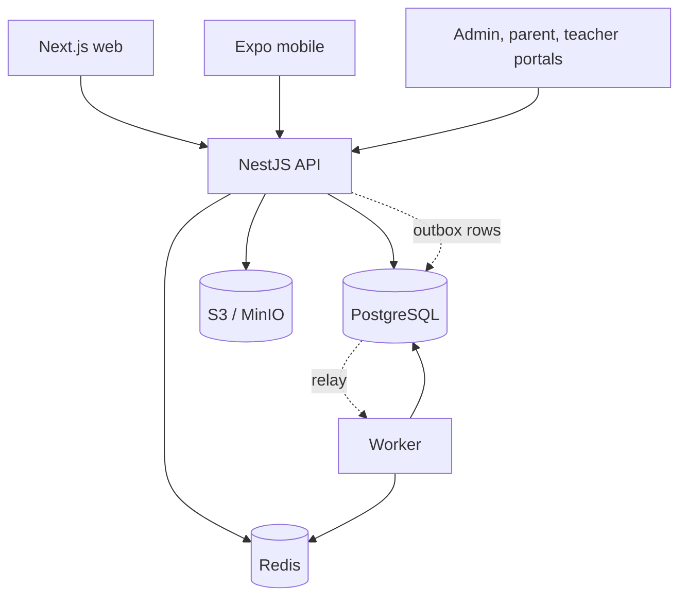

# IMPULSE WORLD Architecture

The master specification is [IMPULSE_WORLD_ARCHITECTURE.md](IMPULSE_WORLD_ARCHITECTURE.md). This document records how it is realised in this repository. Where they differ, the reason is in an ADR.

- Assessment and gaps: [docs/architecture/repository-assessment.md](docs/architecture/repository-assessment.md)
- Modules, ownership and dependencies: [docs/architecture/domain-boundaries.md](docs/architecture/domain-boundaries.md)
- Tenancy: [docs/architecture/tenancy.md](docs/architecture/tenancy.md)
- Database plan: [docs/database/schema-overview.md](docs/database/schema-overview.md)
- Decisions: [DECISIONS.md](DECISIONS.md)

## System overview

A modular monolith with three runtime entrypoints built from one image:

| Process   | Entrypoint               | Responsibility                   |
| --------- | ------------------------ | -------------------------------- |
| `api`     | `apps/api/src/main.ts`   | REST API at `/api/v1`            |
| `worker`  | `apps/api/src/worker.ts` | Outbox relay and event consumers |
| `gateway` | Stage 8                  | Socket.IO real-time traffic      |



## Target directory structure

Items marked _(planned)_ do not exist yet. A package is only created when it has real content; empty placeholders are not committed. See [ADR-010](docs/decisions/ADR-010-incremental-workspace.md).

```text
.
├── apps/
│   ├── api/                  NestJS API, worker and Prisma schema
│   │   ├── prisma/
│   │   │   ├── schema/       one .prisma file per domain group
│   │   │   ├── migrations/
│   │   │   └── seed.ts
│   │   ├── src/
│   │   │   ├── main.ts, worker.ts, instrument.ts, app.module.ts
│   │   │   ├── common/       guards, filters, interceptors, pipes
│   │   │   ├── infrastructure/  database, cache, storage, queue, email, events, telemetry
│   │   │   └── modules/      one folder per business capability
│   │   └── test/             integration, isolation and catalog suites
│   ├── web/                  Next.js child and family experience
│   ├── mobile/               Expo (planned, Stage 4)
│   ├── admin/                Admin CMS (planned, Stage 10)
│   ├── parent-portal/        (planned, Stage 8)
│   ├── teacher-portal/       (planned, Stage 8)
│   └── storybook/            (planned, with packages/ui)
├── packages/
│   ├── config/               shared tsconfig and eslint presets
│   ├── contracts/            zod schemas, permissions, event and error catalogues
│   ├── api-client/           typed client (planned, Stage 3)
│   ├── ui/, design-tokens/   (planned, Stage 3)
│   ├── game-sdk/, game-engine/, game-registry/  (planned, Stage 4)
│   ├── learning-sdk/, analytics-sdk/  (planned)
│   └── localization/         Uzbek, English and Russian text
├── infrastructure/
│   ├── compose/              Postgres role bootstrap
│   └── docker/               production images (planned, Stage 11)
├── docs/
├── scripts/                  repository checks and setup
├── .github/workflows/
├── docker-compose.yml
├── pnpm-workspace.yaml
└── turbo.json
```

Inside a module, the layered layout from spec section 5 is used where it earns its keep. A simple CRUD capability does not get empty `domain/` folders, as the spec itself allows.

```text
modules/<name>/
├── index.ts            public API; the only import path other modules may use
├── domain/             pure rules, no framework or database imports
├── application/        use cases, transaction boundaries, events
├── infrastructure/     Prisma repositories
├── presentation/       controllers
└── <name>.module.ts
```

## Core rules

1. **Tenant identity is derived, never accepted.** It comes from a signed token whose tenant was validated against membership. See [tenancy](docs/architecture/tenancy.md).
2. **Each table has one owning module.** Other modules call its public API or react to its events.
3. **Rules live in domain services**, so they can be tested without a database.
4. **State changes and their events commit together** through the transactional outbox. ADR-007.
5. **The server is authoritative** for scores, XP, coins and mastery.
