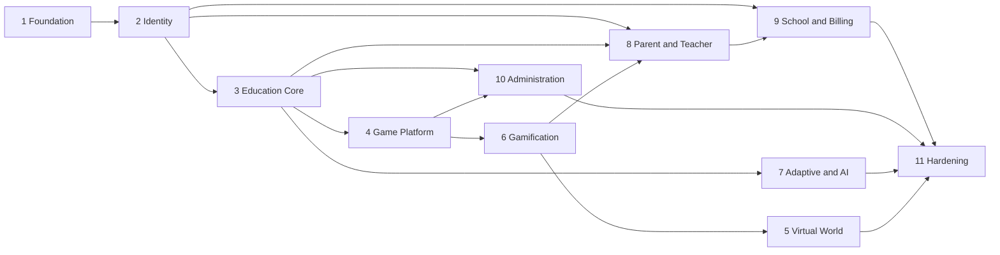

# Implementation Plan

Executable roadmap for [IMPULSE_WORLD_ARCHITECTURE.md](IMPULSE_WORLD_ARCHITECTURE.md). Stages follow spec section 38, and their order comes from the [domain dependency map](docs/architecture/domain-boundaries.md). Current state is in [DEVELOPMENT_STATUS.md](DEVELOPMENT_STATUS.md), which is the only place progress is recorded.

## Definition of done

A feature is done only when all of these hold (spec 37.5): migrations exist, business rules are implemented, contracts are defined, authorization is implemented, frontend integration works, errors are handled, tests pass, documentation is updated, and no known critical security issue remains.

A stage is done when all its acceptance criteria are verified by a command or test named in the status file.

## Dependency summary

**Order change from the spec:** Stage 6 (Gamification) is built before Stage 5 (Virtual World), keeping the spec's numbering. World unlocks need quests, milestones and avatars to exist, and the dependency map requires that order.

## Cross-cutting requirements per stage

Every stage must also deliver: permissions added to the catalogue, RLS and grants in its migrations, entries in the table ownership map, OpenAPI coverage, isolation tests for new tenant tables, and localised strings in Uzbek, English and Russian for anything user-facing.

---

## Stage 1: Engineering Foundation

**Depends on:** nothing.

| Task                                                    | Acceptance criteria                                                           | Tests                           |
| ------------------------------------------------------- | ----------------------------------------------------------------------------- | ------------------------------- |
| Monorepo (pnpm, Turborepo, strict TS, ESLint, Prettier) | `pnpm lint`, `pnpm typecheck`, `pnpm build` pass from clean                   | CI                              |
| Local infrastructure (Postgres, Redis, MinIO, Mailpit)  | `docker compose up` gives healthy services on non-conflicting ports           | Health checks                   |
| Validated configuration                                 | API refuses to boot on missing or weak settings                               | Unit                            |
| Three-role database access                              | Runtime role cannot bypass RLS                                                | Catalog test                    |
| Transaction-scoped tenant context                       | Context does not leak between pooled connections                              | Integration                     |
| Response envelope, errors, request ids, validation      | Uniform responses and no stack traces to clients                              | Integration                     |
| Logging with redaction                                  | Tokens, passwords and child fields never appear in logs                       | Unit                            |
| Metrics, health, tracing, Sentry hooks                  | `/health/live`, `/health/ready` and `/metrics` work; tracing is opt-in by env | Integration                     |
| Rate limiter on Redis                                   | Limits enforced across processes, fail modes per ADR-005                      | Integration                     |
| Tenant-aware cache and storage                          | Keys cannot be built without a tenant                                         | Unit, integration against MinIO |
| Transactional outbox, relay, idempotent consumers       | No lost or duplicated effects under redelivery                                | Integration                     |
| Architecture lint and table ownership check             | Forbidden imports fail the build                                              | CI script                       |
| CI pipeline                                             | Lint, typecheck, unit, integration, build, audit                              | GitHub Actions                  |

**Blockers:** none.

## Stage 2: Identity and Organization

**Depends on:** Stage 1.

| Task                                                                          | Acceptance criteria                                                                       | Tests                     |
| ----------------------------------------------------------------------------- | ----------------------------------------------------------------------------------------- | ------------------------- |
| Adult registration                                                            | Atomically creates user, family tenant, root org, membership, owner role, audit and event | Integration               |
| Login, refresh rotation, reuse detection, logout, session list and revocation | Reused token revokes the session; revoked sessions fail at once                           | Unit, integration         |
| Cookie and bearer transport with CSRF                                         | Cookie requests without a CSRF token fail                                                 | Integration               |
| Tenant switching                                                              | Only with active membership; no client tenant accepted elsewhere                          | Isolation                 |
| Password recovery                                                             | Single use, expiring, no account enumeration, revokes sessions                            | Integration               |
| RBAC and permission guard                                                     | Catalogue synchronised with the database; default deny                                    | Unit, integration         |
| Organizations, branches and departments                                       | Tree stays within a tenant                                                                | Integration               |
| Memberships and invitations                                                   | Invitation is single use and bound to its tenant                                          | Integration               |
| Child provisioning and child sign-in                                          | No email required; lockout enforced                                                       | Integration               |
| Guardian links                                                                | Multiple guardians; the last one cannot be removed                                        | Unit, integration         |
| Consent                                                                       | Versioned, scoped; revoking ends child sessions                                           | Integration               |
| Child settings                                                                | Only guardians can change them; children cannot                                           | Integration               |
| Audit log                                                                     | Append-only at the database level                                                         | Catalog test              |
| MFA for privileged administrators                                             | TOTP, secrets encrypted; platform actions require it                                      | Unit, integration         |
| Web sign-in and family dashboard                                              | Register, sign in, add a child and sign out in a browser                                  | Playwright                |
| Isolation suite                                                               | Cross-tenant reads and writes are denied, and RLS denies independently                    | `apps/api/test/isolation` |

**Blockers:** O2 (legal wording) blocks launch, not implementation.

## Stage 3: Education Core

**Depends on:** Stage 2.

Subjects, curricula, grade levels, objectives and skills with prerequisites. Learning paths, units and lessons. Generic content lifecycle (`DRAFT → IN_REVIEW → APPROVED → PUBLISHED → ARCHIVED`, plus rejection to `DRAFT`). Translations. Question banks and all 11 question types. Assessment attempts and evaluation. Enrollment and progress. `packages/ui`, `design-tokens`, `localization` and `api-client`.

**Acceptance:** a reviewer can approve and a creator cannot self-publish; published versions cannot be changed; historical results keep their version; mastery uses multiple observations; a learner completes a lesson and assessment in the web app.

**Tests:** lifecycle state machine, evaluators per question type, mastery calculation, version pinning.

## Stage 4: Game Platform

**Depends on:** Stage 3.

`game-sdk`, `game-engine` and `game-registry`. Strict config schemas. Sessions with a server-validated state machine. Server replay scoring. Offline packages and idempotent sync. Partitioned event tables. Roughly 10 templates that cover all 45 catalogue games. Expo app shell and WebView bridge proof.

**Acceptance:** a tampered client score changes nothing; replays are rejected; a stale offline result grants nothing; each game has objective, age range, skill mapping, difficulty, rules, feedback, accessibility and analytics.

**Tests:** scoring determinism across client and server, state transitions, sync conflict cases.

## Stage 6: Gamification (built before Stage 5)

**Depends on:** Stage 4.

Ledgers for XP and coins, idempotent reward consumers, configurable rules, redemption, achievements, the quest engine, inventory, avatars, and pseudonymous, scoped leaderboards.

**Acceptance:** no balance can change without a ledger row; a duplicated event credits once; quests complete only from verified events; no loot boxes or real-money conversion exists in the code.

**Tests:** ledger concurrency, idempotency, quest conditions.

## Stage 5: Virtual World

**Depends on:** Stages 3 and 6.

Worlds, regions, locations, characters, skill-based unlock rules, collectibles, a 2D map on web and mobile, and a Three.js scene where supported.

**Acceptance:** unlocks follow learning milestones, never time alone; every world is fully usable in 2D and by keyboard.

## Stage 7: Adaptive Learning and AI

**Depends on:** Stage 3.

Configurable mastery, the decision pipeline, multi-attempt difficulty changes, spaced repetition, explainable recommendations, AI provider adapters with timeouts, quotas, cost tracking, moderation and audit, the tutor, and AI drafts entering human review.

**Acceptance:** one wrong answer never lowers difficulty; each recommendation has a reason; AI content cannot reach children unreviewed; provider payloads contain no child profile data.

**Blockers:** O6.

## Stage 8: Parent and Teacher Ecosystem

**Depends on:** Stages 2, 3 and 6.

Parent portal, teacher portal, classrooms, enrollment, assignments, assessment review, reports, notifications through BullMQ, and the Socket.IO gateway with tenant-aware rooms.

**Acceptance:** a teacher sees only their classrooms; a parent sees only linked children and cannot alter results; no private child data reaches classroom rooms.

**Blockers:** O3, O4, O7.

## Stage 9: School and Business Management

**Depends on:** Stages 2 and 8.

Academic years, terms and schedules. Institutional analytics. Plans, entitlements and quotas. Payment adapters with verified webhooks, and tenant branding.

**Acceptance:** an entitlement activates only from a verified webhook; a duplicate webhook is a no-op; no card data is stored.

**Blockers:** O5.

## Stage 10: Platform Administration

**Depends on:** Stages 3, 4 and 9.

Global CMS, approval queues, visual game builder, user and tenant administration, audit views, support tools with scoped and audited access, and feature flags.

**Acceptance:** creators build a game with no code; no CMS field can execute script; every privileged action needs MFA and is audited.

## Stage 11: Production Hardening

**Depends on:** all stages.

Load tests against the capacity targets, a penetration test, backup restoration drill, disaster recovery, WCAG audit, device testing, and production deployment.

**Acceptance:** spec section 39 in full. The platform is not called production-ready before this.

**Blockers:** O1, O2.
