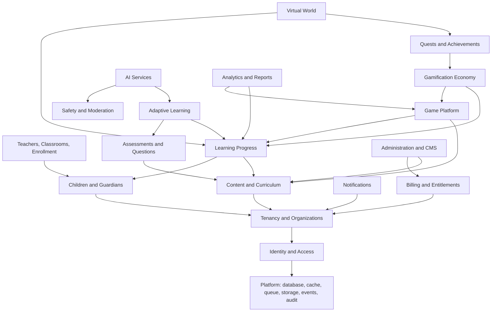

# Domain Boundaries, Ownership and Dependencies

## Boundary rules

Enforced by `.dependency-cruiser.cjs` and `scripts/check-table-ownership.mjs`, both of which run in CI.

1. A module may import another module only through its `index.ts`.
2. `domain/` may not import `infrastructure/`, `presentation/`, NestJS or Prisma.
3. A module reads and writes only the tables it owns.
4. `packages/*` may never import from `apps/*`.
5. Client applications may never import Prisma or server-only packages.
6. No circular dependencies.

Synchronous calls go through the public API when the caller needs the answer now, for example an authorization check. Everything else goes through domain events.

Two arrangements keep the graph acyclic:

- `identity` declares the `AccessDirectory` port and `organizations` implements it, so the auth guard needs no dependency on organizations.
- `onboarding` owns no tables. It composes workflows that span domains, such as registration, inside one transaction.

## Domain dependency map

An arrow means "depends on". This map determines the stage order.

Modules depend on each other only through events where the arrow runs against the data flow. For example, `learning-progress` publishes `lesson.completed`, and `gamification` consumes it. Learning code never calls rewards directly.

## Table ownership

`G` = platform-global. `T` = tenant-owned with enforced RLS. `G+T` = rows of both kinds, separated by a nullable `tenant_id`.

| Module                                 | Tables                                                                                                                                                                                                                               | Scope | Stage |
| -------------------------------------- | ------------------------------------------------------------------------------------------------------------------------------------------------------------------------------------------------------------------------------------ | ----- | ----- |
| `identity`                             | `users`, `user_profiles`, `user_credentials`, `user_sessions`, `refresh_tokens`, `password_reset_tokens`, `user_mfa_factors`                                                                                                         | G     | 2     |
| `identity`                             | `roles`, `permissions`, `role_permissions`                                                                                                                                                                                           | G     | 2     |
| `tenants`                              | `tenants`                                                                                                                                                                                                                            | G     | 2     |
| `tenants`                              | `tenant_settings`                                                                                                                                                                                                                    | T     | 2     |
| `organizations`                        | `organizations`, `organization_members`, `organization_invitations`                                                                                                                                                                  | T     | 2     |
| `organizations`                        | `user_roles`                                                                                                                                                                                                                         | G+T   | 2     |
| `children`                             | `child_profiles`, `child_settings`, `child_consents`                                                                                                                                                                                 | T     | 2     |
| `children`                             | `child_preferences`, `child_devices`                                                                                                                                                                                                 | T     | 8     |
| `guardians`                            | `parent_profiles`, `parent_child_links`                                                                                                                                                                                              | T     | 2     |
| `audit`                                | `audit_logs`                                                                                                                                                                                                                         | G+T   | 2     |
| `infrastructure/events`                | `outbox_events`, `consumed_events`                                                                                                                                                                                                   | G+T   | 1     |
| `teachers`, `classrooms`, `enrollment` | `teacher_profiles`, `classrooms`, `classroom_teachers`, `classroom_students`, `assignments`                                                                                                                                          | T     | 8     |
| `subjects`, `curriculum`               | `subjects`, `subject_translations`, `curriculums`, `curriculum_versions`, `grade_levels`, `learning_objectives`, `skills`, `skill_dependencies`                                                                                      | G+T   | 3     |
| `learning-paths`, `lessons`            | `learning_paths`, `learning_path_versions`, `learning_path_nodes`, `units`, `lessons`, `lesson_versions`, `lesson_blocks`, `lesson_assets`                                                                                           | G+T   | 3     |
| `content`                              | `content_items`, `content_versions`, `content_translations`, `content_assets`, `content_categories`, `content_tags`, `content_reviews`, `content_approvals`, `content_publications`, `content_localizations`                         | G+T   | 3     |
| `questions`, `assessments`             | `question_banks`, `questions`, `question_versions`, `question_options`, `assessment_templates`, `assessment_versions`, `assessment_items`, `assessment_attempts`, `assessment_responses`, `assessment_results`, `assessment_rubrics` | G+T   | 3     |
| `learning-progress`                    | `learning_enrollments`, `learning_progress`, `skill_mastery`                                                                                                                                                                         | T     | 3     |
| `game-catalog`                         | `game_templates`, `game_versions`, `game_categories`, `game_modes`, `game_content_bindings`                                                                                                                                          | G+T   | 4     |
| `game-sessions`                        | `game_sessions`, `game_session_events`, `game_results`, `game_attempts`, `game_unlocks`                                                                                                                                              | T     | 4     |
| `worlds`                               | `worlds`, `world_regions`, `world_locations`, `world_characters`, `world_unlock_rules`, `player_world_progress`                                                                                                                      | G+T   | 5     |
| `rewards`                              | `player_profiles`, `player_levels`, `player_experience`, `experience_transactions`, `wallets`, `wallet_transactions`, `reward_catalog`, `reward_redemptions`                                                                         | G+T   | 6     |
| `achievements`                         | `achievements`, `achievement_conditions`, `player_achievements`                                                                                                                                                                      | G+T   | 6     |
| `quests`                               | `quests`, `quest_versions`, `quest_steps`, `quest_assignments`, `quest_progress`                                                                                                                                                     | G+T   | 6     |
| `inventory`, `avatars`                 | `inventory_items`, `player_inventory`, `avatar_definitions`, `player_avatars`                                                                                                                                                        | G+T   | 6     |
| `leaderboards`                         | `streak_records`, `leaderboards`, `leaderboard_entries`                                                                                                                                                                              | T     | 6     |
| `adaptive-learning`                    | `recommendations`, `revision_schedules`                                                                                                                                                                                              | T     | 7     |
| `ai`                                   | `ai_requests`, `ai_usage`, `ai_content_drafts`                                                                                                                                                                                       | T     | 7     |
| `notifications`                        | `notifications`, `notification_preferences`, `notification_deliveries`                                                                                                                                                               | T     | 8     |
| `subscriptions`, `billing`             | `plans`, `plan_entitlements`, `subscriptions`, `usage_counters`, `invoices`, `payments`, `refunds`, `payment_webhook_events`                                                                                                         | G+T   | 9     |
| `analytics`                            | `learning_events`, `game_analytics_events`, `assessment_analytics`, `daily_activity_summaries`, `weekly_progress_summaries`, `skill_mastery_snapshots`, `organization_analytics`                                                     | T     | 4, 8  |
| `moderation`, `safety`                 | `moderation_cases`, `data_export_requests`, `data_deletion_requests`                                                                                                                                                                 | T     | 8     |
| `administration`                       | `feature_flags`, `feature_flag_overrides`                                                                                                                                                                                            | G+T   | 10    |

Global educational content is `G+T`: `tenant_id IS NULL` is platform-authored and readable by every tenant, while rows with a `tenant_id` are private to that school. The RLS policy for these tables differs from strict tenant tables. See [tenancy](tenancy.md).
